<p align="center">
  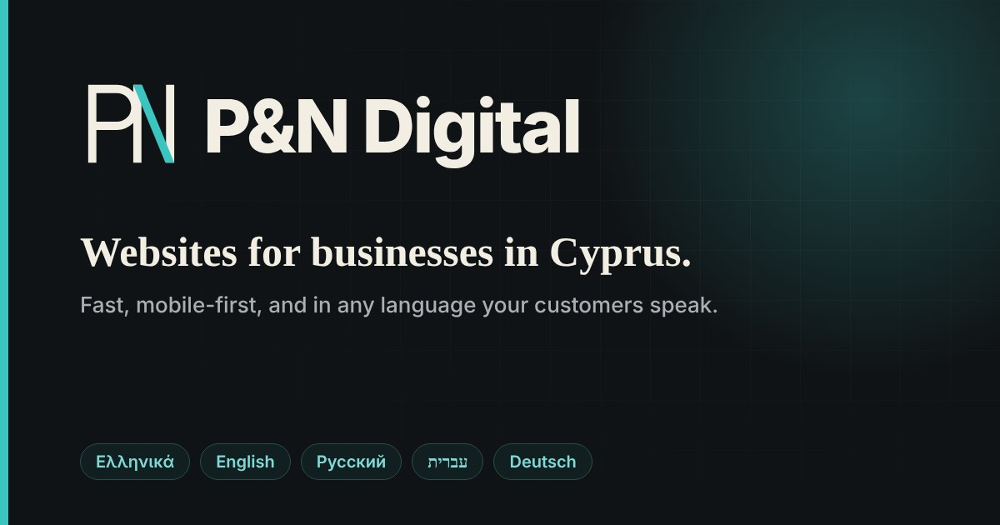
</p>

<h1 align="center">P&N Digital — agency website</h1>

<p align="center">
  The website and interactive portfolio of <strong>P&N Digital</strong>, a web design studio in Cyprus.<br>
  Hand-built in plain HTML, CSS and JavaScript · English and Greek · no frameworks, no build step.
</p>

<p align="center">
  
  
  
  
  
  
</p>

---

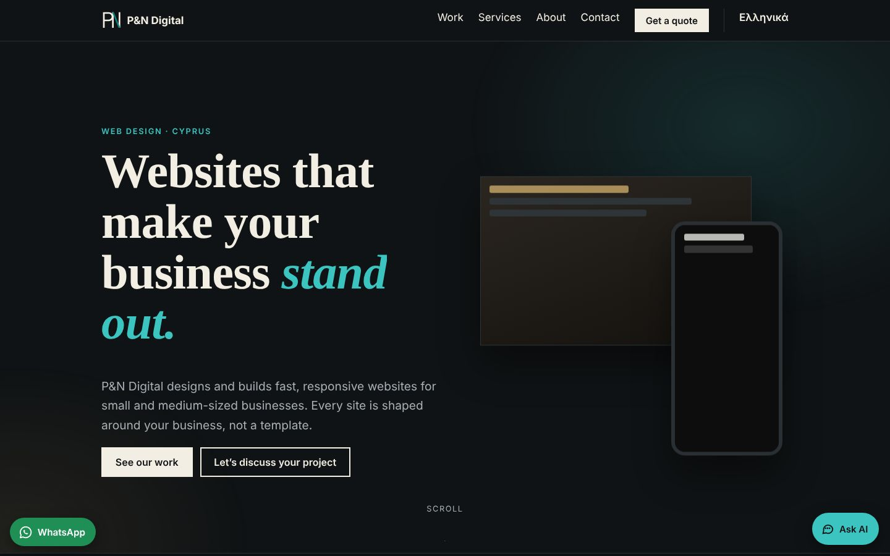

## Highlights

| | |
|---|---|
| **Interactive portfolio** | Three complete demo websites (restaurant, barbershop, consultancy) open in a live preview with a desktop / phone switch, or full-screen. |
| **Two languages everywhere** | Every page exists in English and Greek (`/el/`), with `hreflang`, a language switcher, and demos that follow the visitor's language. |
| **Language guarantee** | Packages include 2, 3 or 5 languages; right-to-left languages such as Hebrew and Arabic are supported. |
| **Quote calculator** | Visitors pick pages, languages and extras and see the matching package and starting price live, then send the estimate on WhatsApp or by email. |
| **Contact without a backend** | The form opens the visitor's own WhatsApp or email app with the message ready. Nothing is sent or stored by the site. |
| **AI assistant** | A chat assistant on every page and demo, powered by the separate [`pn-digital-ai-assistant`](https://github.com/tsiopouras/pn-digital-ai-assistant) engine. Runs in a clearly labelled demo mode until the engine is deployed. |
| **"How we built it"** | Each project page shows a wireframe-to-finished slider, measured code stats and the build story. |
| **Accessible and fast** | Semantic HTML, keyboard support, visible focus, reduced-motion support, no framework JavaScript, lazy-loaded images. |

<table>
  <tr>
    <td width="50%">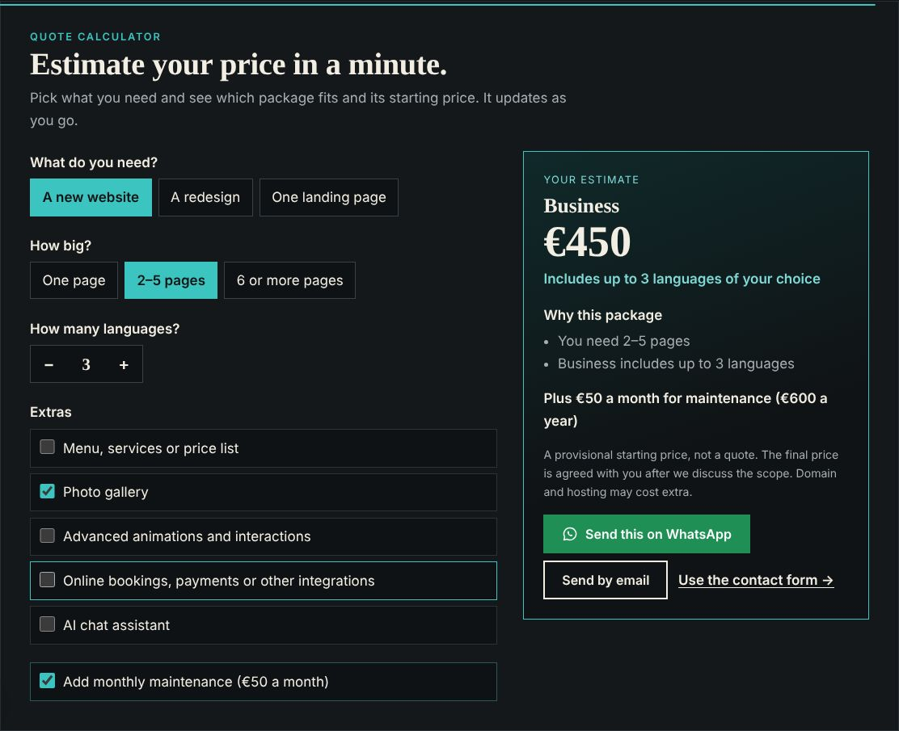<br><sub><b>Quote calculator</b> — package and starting price update as you choose.</sub></td>
    <td width="50%">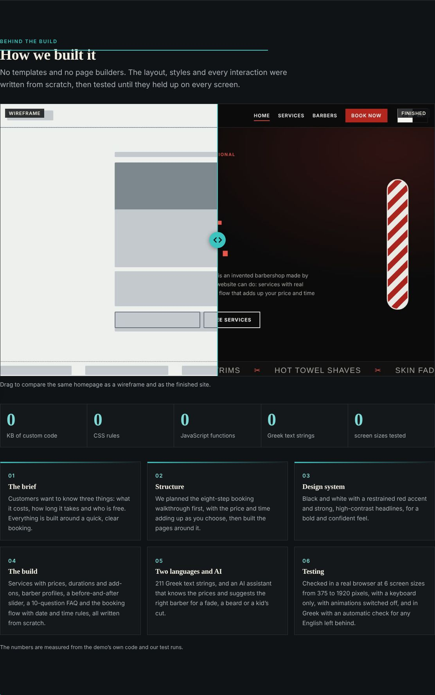<br><sub><b>How we built it</b> — drag between the wireframe and the finished site.</sub></td>
  </tr>
  <tr>
    <td>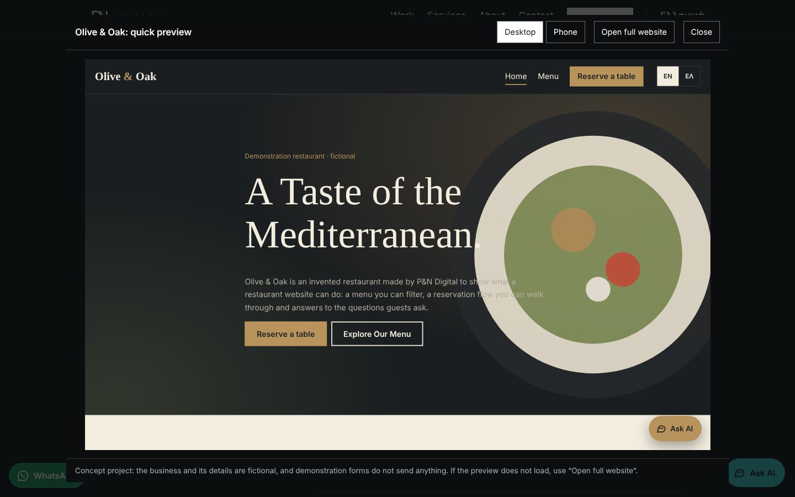<br><sub><b>Live preview</b> — the real demo running inside the portfolio.</sub></td>
    <td>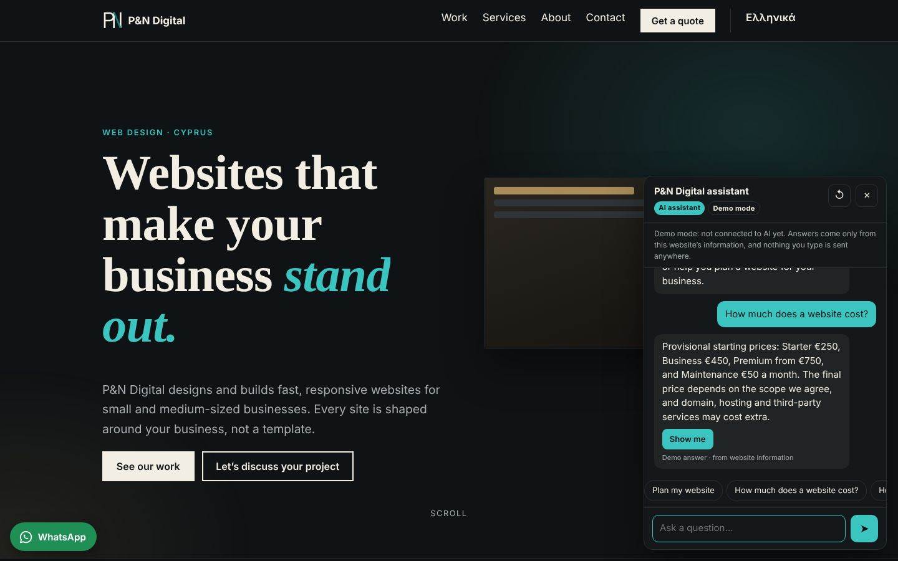<br><sub><b>AI assistant</b> — answers from the site's own information.</sub></td>
  </tr>
  <tr>
    <td>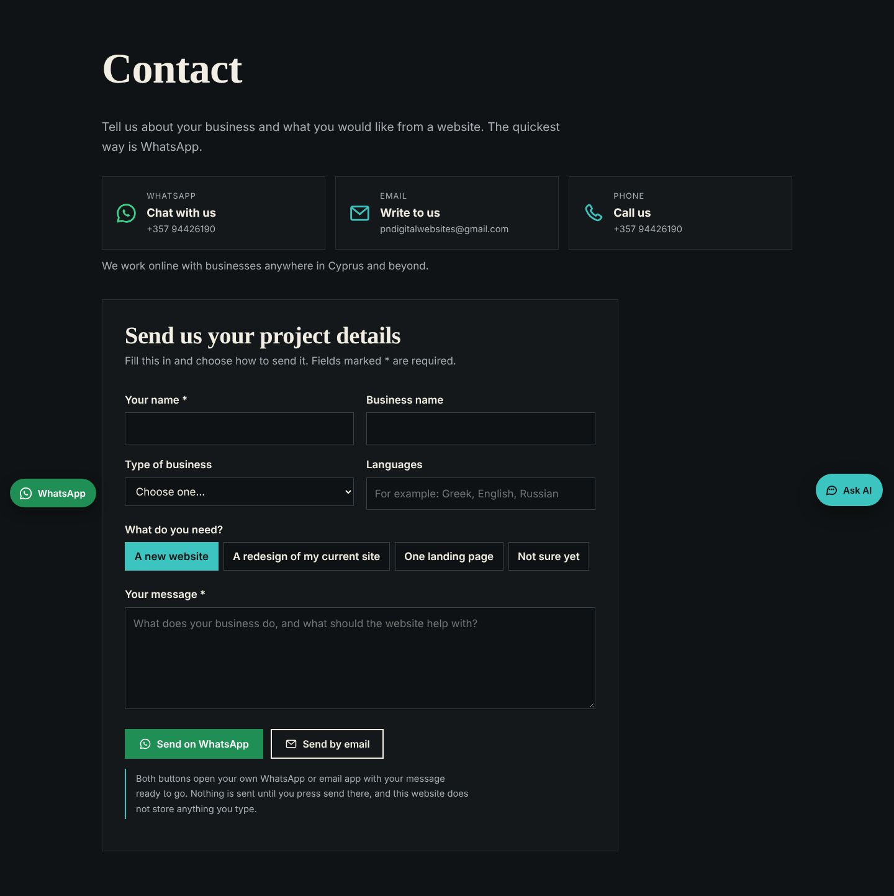<br><sub><b>Contact</b> — WhatsApp, email and phone, plus a form with no backend.</sub></td>
    <td align="center">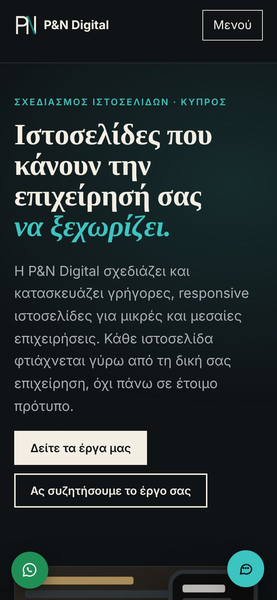<br><sub><b>Greek, on a phone.</b></sub></td>
  </tr>
</table>

### The demo websites

| Olive & Oak · restaurant | THE CUT · barbershop | Nexora · consultancy |
|---|---|---|
| 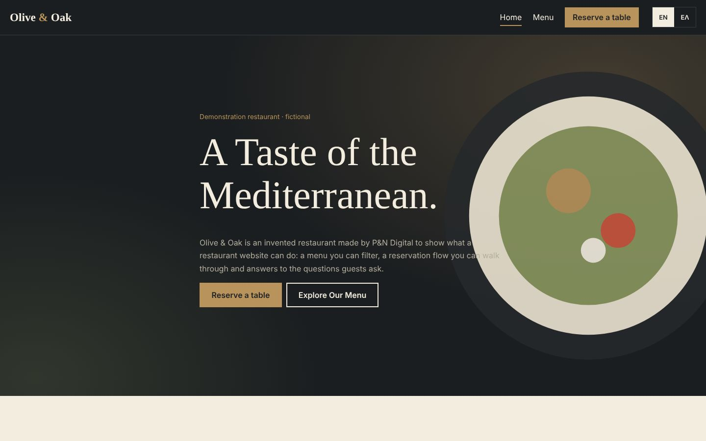 | 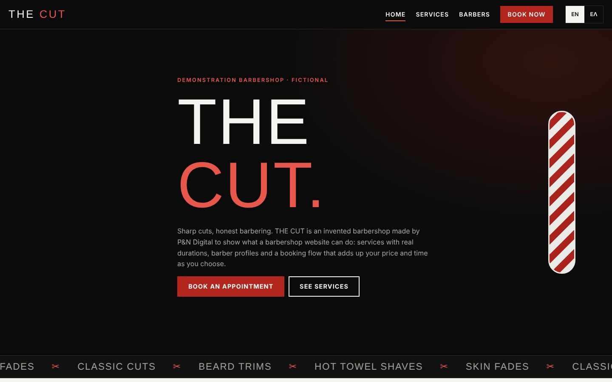 | 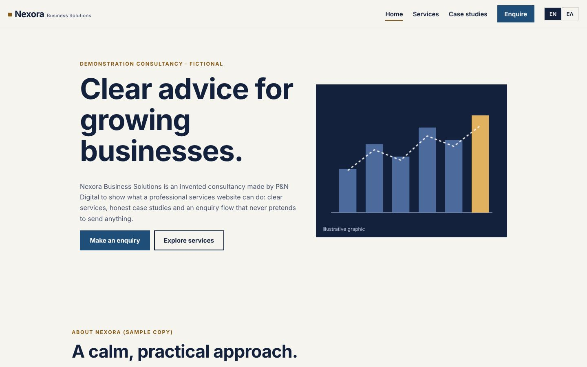 |
| Filterable 18-dish menu, 8-step reservation walkthrough | Services with prices and times, 8-step booking that adds up | Services, illustrative case studies, 7-step enquiry |

All three businesses are fictional and clearly labelled as demos. Their forms never send anything.

## Run it on your computer

The pages use links that start with `/` (for example `/css/styles.css`), so they need a small local web server. Opening `index.html` by double-clicking shows an unstyled page.

**Option A: VS Code (easiest)**
1. Open the **`public`** folder in VS Code (*File → Open Folder*).
2. Install the **Live Server** extension, then right-click `index.html` → **Open with Live Server**.

**Option B: one terminal command** (needs Python)
```bash
python -m http.server 5500 --directory public
```
Then open <http://localhost:5500>.

## Project structure

```
public/                 ← the website (this folder is what gets published)
  index.html            English homepage      el/            Greek copies of every page
  work/ services/ about/ contact/ projects/   one folder per page
  demos/                the three demo websites (one self-contained file each)
  css/styles.css        all styles
  js/                   site-config.js (contact details), projects.js (portfolio list),
                        main.js, fx.js (animations), preview.js (live preview), forms.js
                        (WhatsApp, contact form, quote calculator, comparison slider)
  assets/               favicon, share images (og/), AI assistant widget and packs
  images/build/         "How we built it" screenshots
  sitemap.xml robots.txt _headers 404.html
docs/                   progress notes, test report, image sources, brand files, screenshots
tests/                  automated browser tests (Playwright)
tools/                  scripts that regenerate images and the single-file test copy
```

## Editing

- **Contact details** live in `public/js/site-config.js` *and* directly in the pages (so they work without JavaScript). Search and replace both.
- **English and Greek are separate files.** When you change text, change `public/…` and `public/el/…`.
- **Header or footer text** appears on every page: use *Edit → Replace in Files* in VS Code.
- **Prices** appear on the homepage, the services page (both languages), the quote calculator (`public/js/forms.js`) and the AI assistant's knowledge (in the engine repository). Keep them in step.
- **What the AI assistant knows** is edited in the [`pn-digital-ai-assistant`](https://github.com/tsiopouras/pn-digital-ai-assistant) repository, then exported into `public/assets/assistant/packs/`.

## Tests

The tests open the site in a real browser (Chromium via Playwright) and check every page, both languages, phone and desktop sizes, the previews, the forms, the calculator and the assistant.

```bash
pip install playwright pillow
python -m playwright install chromium
python tests/test_site.py            # pages, links, languages, layout at 6 screen sizes
python tests/test_contact_quote.py   # WhatsApp, contact form, quote calculator, build sections
python tests/test_demo_i18n.py       # Greek translation of the demos
python tests/test_assistant.py       # AI assistant (needs Node.js and the engine repo cloned next to this one)
python tools/build_test_copy.py && python tests/test_hosted.py   # the single-file test copy
```

## Publishing

Nothing is published yet. When the domain is ready:

1. Replace the placeholder `https://pn-digital.example` everywhere in `public/` (canonical links, `hreflang`, share images, `sitemap.xml`, `robots.txt`).
2. Publish the **`public`** folder with Cloudflare Pages (or any static host). No build command is needed; the output folder is `public`.
3. Add the new address to `allowedOrigins` in the AI assistant engine.

See [`docs/PROGRESS.md`](docs/PROGRESS.md) for the full status and to-do list.

## Status

- ✅ English and Greek, portfolio, live previews, quote calculator, contact, AI assistant (demo mode), share images
- ⏳ Real domain and publishing · native-speaker review of the Greek · real photography and client reviews (once there are clients)

---

<p align="center"><sub>© 2026 P&N Digital · pndigitalwebsites@gmail.com · +357 94426190<br>All rights reserved. This code is not licensed for reuse.</sub></p>
